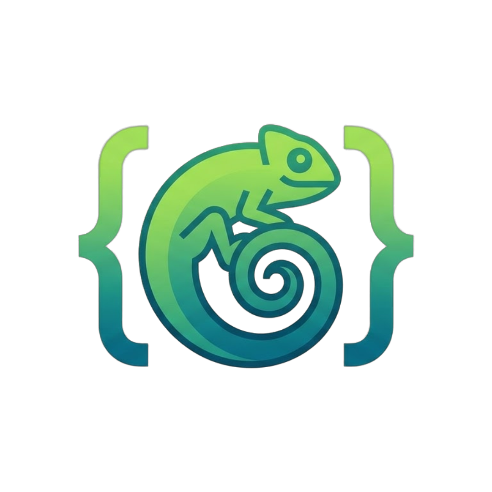

# Lizard

<b>Simple. Strict. Kind.</b>

An interpreted programming language written in C.

## Documentation

- [docs/VISION.md](docs/VISION.md) — the design: Simple. Strict. Kind.
- [docs/SYNTAX.md](docs/SYNTAX.md) — programs, comments, let/const, blocks, operators, precedence
- [docs/TYPES.md](docs/TYPES.md) — type system: int, float, bool, nil, string, optionals, unions
- [docs/CONTROL_FLOW.md](docs/CONTROL_FLOW.md) — if, while, for, break, continue
- [docs/FUNCTIONS.md](docs/FUNCTIONS.md) — functions, parameters, named arguments, closures
- [docs/COLLECTIONS.md](docs/COLLECTIONS.md) — arrays and dicts
- [docs/STRINGS.md](docs/STRINGS.md) — literals, templates, format specs
- [docs/ERRORS.md](docs/ERRORS.md) — try/catch/finally/throw and error reports
- [docs/CLASSES.md](docs/CLASSES.md) — classes, inheritance, traits, links
- [docs/METHODS.md](docs/METHODS.md) — methods and callbacks on values
- [docs/CLI.md](docs/CLI.md) — `lizard` command-line options and exit codes
- [docs/MEMORY.md](docs/MEMORY.md) — ownership, reference cycles, links
- [docs/ENGINE.md](docs/ENGINE.md) — Gecko Engine, reference interpreter, JIT
- [docs/DEVELOPING.md](docs/DEVELOPING.md) — tests, sanitizers, contributing

## License
This project is licensed under Apache-2.0, See [LICENSE](LICENSE) for more information.
